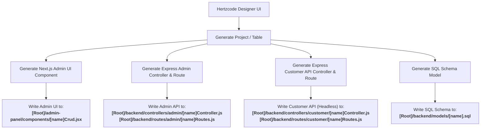

# Finalized Hertzcode Architecture & Code Generation Structure

Hertzcode generates:
1. **Node.js / Express MVC Backend**:
   - **Admin Backend API**: `backend/controllers/admin/` & `backend/routes/admin/` (Accessible at `/api/apiAdmin/[tableName]` and `/api/admin/[tableName]`).
   - **Customer Backend API (Headless)**: `backend/controllers/customer/` & `backend/routes/customer/` (Accessible at `/api/apiCustomer/[tableName]` and `/api/customer/[tableName]`).
2. **Next.js Premium Admin Panel UI**:
   - **Admin Management UI**: `admin-panel/components/[tableName]Crud.jsx` & `admin-panel/app/[tableName]/page.jsx`.
   - **Note**: No Customer Website UI is generated. The Customer API is headless so any external mobile app or custom consumer frontend can consume `/api/apiCustomer/[tableName]`.

---

## 1. Code Generation Flow Chart



---

## 2. Directory Tree Representation
When you generate a project into a destination folder (e.g. `c:\Users\Faizan\Desktop\MyProject`), Hertzcode bootstraps the following layout:

```text
[Root Destination Folder]
├── backend/
│   ├── package.json               <-- Express & MySQL dependencies
│   ├── server.js                  <-- Express server with security & auto-reloading
│   ├── config/
│   │   └── db.js                  <-- Centralized MySQL connection pool
│   ├── middleware/
│   │   ├── authMiddleware.js      <-- JWT verification & role authorization
│   │   └── uploadMiddleware.js    <-- Whitelisted file uploads with 10MB limits
│   ├── utils/
│   │   └── authHelper.js          <-- Salted scrypt password hashing & JWT helpers
│   ├── controllers/
│   │   ├── admin/
│   │   │   └── [tableName]Controller.js  <-- Admin MVC Controller
│   │   └── customer/
│   │       └── [tableName]Controller.js  <-- Headless Customer API Controller
│   ├── routes/
│   │   ├── admin/
│   │   │   └── [tableName]Routes.js      <-- Mounted at /api/apiAdmin/[tableName]
│   │   └── customer/
│   │       └── [tableName]Routes.js      <-- Mounted at /api/apiCustomer/[tableName]
│   └── models/
│       └── [tableName].sql        <-- Generated SQL schema
│
└── admin-panel/                   <-- Next.js 14+ Premium Admin Template (Single UI)
    ├── package.json
    ├── app/                       <-- Dynamic routing & App Router pages
    │   ├── login/                 <-- Real JWT login handshake
    │   └── [tableName]/           <-- Handcrafted or dynamic CRUD pages
    │       ├── page.jsx
    │       └── layout.jsx
    ├── components/                <-- Generated CRUD management screens
    │   └── [tableName]Crud.jsx
    ├── config/
    │   └── menu.js                <-- Dynamically generated sidebar navigation
    └── registry.js                <-- Auto-updated component registry
```

---

## 3. Key Design Principles
- **Dual API Generation (Admin + Headless Customer)**:
  - Admin API endpoints (`/api/apiAdmin/*`) power the Next.js Admin Panel with complete management and audit features.
  - Headless Customer API endpoints (`/api/apiCustomer/*`) provide clean, lightweight REST APIs for public consumer interactions without requiring an auto-generated website UI.
- **Root-Cause Security**:
  - ES Modules architecture with cryptographic JWT signing and salted `crypto.scrypt` password hashing.
  - Strict upload whitelist and 10MB limit.
  - Database access middleware with destructive SQL isolation.
